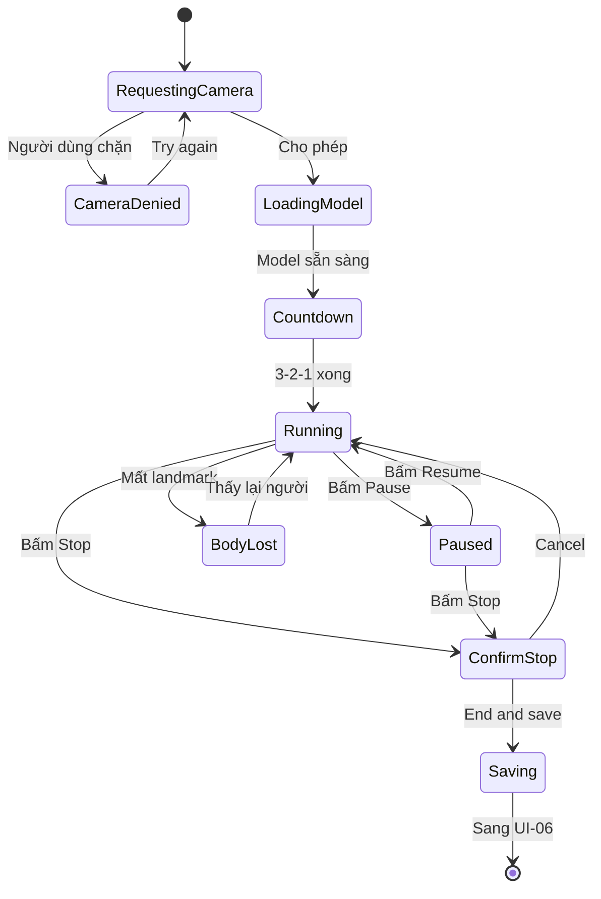

# AIFit – ĐẶC TẢ CHI TIẾT "BẤM VÀO ĐÂU → HIỆN RA GÌ"

> Bổ sung cho [AIFit_UI_Spec.md](./AIFit_UI_Spec.md). File này mô tả **từng nút, từng ô, từng trạng thái** của 15 màn hình (UI-01 → UI-15) theo tài liệu IDD v1.1 + Proposal (FR01–FR07, NFR01–NFR06).
> Chữ trong ngoặc kép "..." là **chữ hiển thị chính xác trên giao diện** (tiếng Anh).
> Ký hiệu: **→** = chuyển trang · **⟳** = hiện loading · **✓** = thành công · **✗** = thất bại · **[mới]** = chi tiết bổ sung hợp lý ngoài tài liệu, có thể bỏ.

---

## MỤC LỤC
0. Quy tắc chung toàn hệ thống
1. UI-01 Login
2. UI-02 Sign up
3. UI-03 Home – Exercise selection
4. UI-04 Exercise Guide
5. UI-05 Live Workout (+ máy trạng thái, logic đếm rep)
6. UI-09 System Messages
7. UI-06 Workout Summary
8. UI-07 Progress & History (+ Session Detail)
9. UI-08 Profile
10. UI-10 Admin Dashboard
11. UI-11 Manage Users
12. UI-12 Manage Exercises
13. UI-13 Manage Exercise Rules
14. UI-14 Add / Edit Rule
15. UI-15 System Logs
16. Bảng tổng hợp chức năng ↔ yêu cầu (checklist)
17. Danh sách toàn bộ thông báo (message catalog)

---

## 0. QUY TẮC CHUNG TOÀN HỆ THỐNG

### 0.1 Phiên đăng nhập
| Tình huống | Hệ thống làm gì |
|---|---|
| Chưa đăng nhập mà gõ URL trang bảo vệ (vd `/history`) | → `/login`, sau khi đăng nhập xong quay lại đúng trang vừa định vào |
| Đã đăng nhập mà vào `/login` hoặc `/signup` | Trainee → `/` ; Admin → `/admin` |
| Trainee gõ URL `/admin/...` | → `/` + toast đỏ "You do not have permission to access this page." |
| Admin vào trang của Trainee (`/`, `/history`...) | → `/admin` |
| Token hết hạn khi đang thao tác (API trả 401) | Toast cam "Your session has expired. Please log in again." → `/login` (nếu đang tập, kết quả buổi tập được lưu tạm vào trình duyệt trước) |
| Tài khoản bị Admin khóa trong lúc đang dùng (API trả 403 locked) | Toast đỏ "Your account has been locked." → đăng xuất → `/login` |
| URL không tồn tại | Trang 404: "Page not found" + nút "Back to Home" |

### 0.2 Thanh điều hướng Trainee (TopNavbar) – có ở UI-03, 04, 06, 07, 08
| Bấm vào | Kết quả |
|---|---|
| Logo "AIFit" | → UI-03 Home |
| "Home" | → UI-03 (mục đang ở được gạch chân màu gold) |
| "History" | → UI-07 |
| "Profile" | → UI-08 |
| Avatar (vòng tròn chữ cái đầu tên) | Mở menu nhỏ: tên + email, "Profile", "Log out" [mới] |
| "Log out" | Mở ConfirmDialog "Log out of AIFit?" [Cancel] [Log out] → bấm Log out: xóa token → UI-01 + toast "You have been logged out." |

> Ở **UI-05 Live Workout** TopNavbar bị **ẩn** để tập trung, chỉ có nút điều khiển. Muốn thoát phải bấm Stop (xem mục 5).

### 0.3 Sidebar Admin – có ở UI-10 → UI-15
| Bấm vào | Kết quả |
|---|---|
| "Dashboard" | → UI-10 |
| "Users" | → UI-11 |
| "Exercises" | → UI-12 |
| "Exercise Rules" | → UI-13 |
| "System Logs" | → UI-15 |
| Khối tài khoản admin (dưới cùng) | Hiện tên + email admin |
| "Log out" | ConfirmDialog "Log out of AIFit?" → UI-01 |
| Đang ở form chưa lưu (UI-12 form, UI-14) mà bấm mục khác | ConfirmDialog "You have unsaved changes. Leave this page?" [Stay] [Leave] |

### 0.4 Thành phần dùng chung – hành vi
| Thành phần | Hành vi |
|---|---|
| Toast | Góc trên phải, tự tắt sau 3s, có nút ✕; xanh = thành công, đỏ = lỗi, cam = cảnh báo |
| ConfirmDialog | Nền mờ phía sau; bấm ngoài hộp hoặc phím Esc = Cancel; nút nguy hiểm màu đỏ |
| Nút đang gửi request | Hiện spinner trong nút + bị vô hiệu (chống bấm 2 lần) |
| Bảng đang tải | Hiện 5 dòng skeleton xám nhấp nháy |
| Bảng rỗng | Icon + câu thông báo rỗng (ghi riêng ở từng màn) |
| Lỗi tải dữ liệu | Khung đỏ nhạt "Something went wrong while loading data." + nút "Try again" (bấm = tải lại) |
| Ô nhập lỗi | Viền đỏ + dòng chữ đỏ dưới ô; lỗi hiện khi rời ô (blur) hoặc khi bấm Submit |
| Phân trang | "‹ Prev" · 1 2 3 … · "Next ›"; trang 1 thì Prev mờ; trang cuối thì Next mờ; 10 dòng/trang |

---

## 1. UI-01 LOGIN (`/login`) — FR05, NFR02

**Vào từ:** mở app lần đầu, Logout, phiên hết hạn, link "Log in" ở UI-02, sau khi đăng ký thành công.
**Ra:** Trainee → UI-03 · Admin → UI-10 · → UI-02.

**Bố cục:** Trái: hình minh họa + slogan "Your AI personal trainer at home". Phải: thẻ "Welcome back" chứa form.

| # | Phần tử | Thao tác | Kết quả hiển thị |
|---|---|---|---|
| 1 | Ô "Email" (placeholder "you@example.com") | Gõ, rời ô | Nếu trống → "Email is required." · Sai định dạng → "Please enter a valid email address." |
| 2 | Ô "Password" (hiện dấu •••) | Gõ | Trống khi Submit → "Password is required." |
| 3 | Icon con mắt cuối ô Password | Bấm | Đổi •••• ↔ chữ thật; icon đổi Eye ↔ EyeOff |
| 4 | Dòng lỗi đỏ phía trên nút | (tự hiện) | Chỉ hiện sau khi đăng nhập thất bại (xem bảng dưới); biến mất khi người dùng gõ lại |
| 5 | Nút **"Log in"** | Bấm / nhấn Enter trong ô | Validate → ⟳ "Logging in..." → gọi API (xem bảng kết quả) |
| 6 | Link "Don't have an account? **Sign up**" | Bấm | → UI-02 |

**Kết quả khi bấm "Log in":**
| Trường hợp | Hiển thị |
|---|---|
| ✓ Đúng, role Trainee | Lưu JWT → UI-03 Home |
| ✓ Đúng, role Admin | Lưu JWT → UI-10 Dashboard |
| ✗ Sai email hoặc mật khẩu | #4: "Invalid email or password." (không nói rõ sai cái nào – bảo mật). Ô password được xóa trống |
| ✗ Tài khoản bị khóa | #4: "Your account has been locked. Please contact the administrator." |
| ✗ Mất mạng / server lỗi | Toast đỏ "Cannot connect to the server. Please try again." |

> API đề xuất: `POST /api/auth/login {email, password}` → `{token, user:{id, fullName, email, role}}`.

---

## 2. UI-02 SIGN UP (`/signup`) — FR05, NFR02

**Vào từ:** link Sign up ở UI-01. **Ra:** UI-01.

| # | Phần tử | Thao tác | Kết quả hiển thị |
|---|---|---|---|
| 1 | Ô "Full name" | Gõ, rời ô | Trống → "Full name is required." |
| 2 | Ô "Email" | Gõ, rời ô | Trống → "Email is required." · Sai định dạng → "Please enter a valid email address." |
| 3 | Ô "Password" + icon mắt | Gõ | Dưới ô có chữ xám "8–50 characters". < 8 → "Password must be at least 8 characters." · > 50 → "Password must be at most 50 characters." |
| 4 | Ô "Confirm password" + icon mắt | Gõ | Không trùng → "Passwords do not match." |
| 5 | Nút **"Create account"** | Bấm | Validate tất cả → ⟳ "Creating account..." → xem bảng |
| 6 | Link "Already have an account? **Log in**" | Bấm | → UI-01 |

**Kết quả khi bấm "Create account":**
| Trường hợp | Hiển thị |
|---|---|
| ✓ Thành công | → UI-01, toast xanh "Account created successfully. Please log in.", ô Email ở UI-01 điền sẵn email vừa đăng ký [mới] |
| ✗ Email đã tồn tại | Dưới ô Email: "This email is already registered." |
| ✗ Server lỗi | Toast đỏ "Cannot create account. Please try again." |

> Tài khoản mới luôn có role **Trainee**, status **Active**. Mật khẩu được băm ở server (NFR02).
> API: `POST /api/auth/register {fullName, email, password}`.

---

## 3. UI-03 HOME – EXERCISE SELECTION (`/`) — FR01, FR04, NFR03

**Vào từ:** đăng nhập (Trainee), logo/Home, nút Back ở UI-04, link Back to Home ở UI-09.
**Khi mở:** ⟳ tải danh sách bài tập Active + buổi tập gần nhất.

| # | Phần tử | Thao tác | Kết quả hiển thị |
|---|---|---|---|
| 1 | TopNavbar | Bấm | Xem mục 0.2 |
| 2 | Lời chào | (chỉ hiển thị) | "Hi, {Full name} 👋" + dòng nhỏ "Choose an exercise to start your workout." |
| 3 | Thẻ **Squat** | Rê chuột | Thẻ nổi lên, viền gold, hiện chữ "Start →" |
| 3 | Thẻ **Squat** | Bấm | → UI-04 Guide của Squat |
| 4 | Thẻ **Plank** | Bấm | → UI-04 Guide của Plank |
| 5 | Thẻ **Push-up** | Bấm | → UI-04 Guide của Push-up |
| 6 | Panel "Latest workout" | (hiển thị) | Tên bài · ngày giờ · Reps (Plank: Hold time) · Accuracy (vòng % – xanh ≥ 80%, cam 50–79%, đỏ < 50%) · Duration |
| 6 | Panel "Latest workout" | Bấm vào panel [mới] | → Session Detail của buổi đó (mục 8.2) |
| 7 | Link "View full history →" | Bấm | → UI-07 |

**Nội dung mỗi thẻ bài tập:** ảnh minh họa · tên · dòng "Joints: Hip › Knee › Ankle" (Squat) / "Shoulder › Hip › Ankle" (Plank) / "Shoulder › Elbow › Wrist" (Push-up) · nhãn kiểu đo "Reps" hoặc "Hold time".

**Các trạng thái:**
| Trạng thái | Hiển thị |
|---|---|
| Đang tải | 3 thẻ skeleton + panel skeleton |
| Người dùng mới (chưa có buổi nào) | Panel #6 **ẩn**, thay bằng: "No workouts yet – pick an exercise above to start your first session!" |
| Admin tắt (Inactive) 1 bài | Thẻ bài đó **không hiện** |
| Không có bài Active nào | "No exercises are available right now. Please come back later." |
| Lỗi tải | Khung lỗi + "Try again" |

> ✅ NFR03: Bấm thẻ (click 1) → bấm Start Workout ở UI-04 (click 2) = **2 click** để bắt đầu.
> API: `GET /api/exercises?status=Active`, `GET /api/sessions/latest`.

---

## 4. UI-04 EXERCISE GUIDE (`/exercise/:id/guide`) — FR01, FR02, NFR02, NFR03

**Vào từ:** thẻ bài ở UI-03; nút "Workout Again" ở UI-06.
**Bố cục:** trái: ảnh tư thế chuẩn lớn; phải: danh sách điểm kiểm tra + hướng dẫn camera + nút Start.

| # | Phần tử | Thao tác | Kết quả hiển thị |
|---|---|---|---|
| 1 | Link "← Back" | Bấm | → UI-03 |
| 2 | Tiêu đề | (hiển thị) | "{Squat} – Exercise Guide" |
| 3 | Ảnh tư thế chuẩn | (hiển thị) | Ảnh tư thế chính của bài, có chú thích góc mục tiêu |
| 4 | Danh sách "What AIFit will check" | (hiển thị) | Các gạch đầu dòng (nội dung theo bài – bảng dưới) |
| 5 | Khung "Camera setup" | (hiển thị) | Hướng nhìn, khoảng cách, thấy toàn thân, ánh sáng + PrivacyNote 🔒 "Video is processed in your browser and never stored." |
| 6 | Nút **"Start Workout"** (gold, lớn) | Bấm | → UI-05, trình duyệt bật hộp xin quyền camera |

**Nội dung theo bài:**

| Bài | What AIFit will check | Camera setup |
|---|---|---|
| **Squat** | • Squat depth: bend knees to 90°–110° (Hip › Knee › Ankle)<br>• Trunk–tibia angle within ±10° (keep chest up)<br>• Do not go deeper than 135° | Đặt camera **ngang hông, nhìn từ bên cạnh**, cách 2–3 m, thấy từ đầu đến chân, phòng đủ sáng, mặc đồ gọn |
| **Plank** | • Shoulder › Hip › Ankle in a straight line (165°–180°)<br>• Hips not sagging<br>• Hips not piking up | Camera **ngang sàn/hông, nhìn từ bên cạnh**, cách ~2 m, thấy toàn thân |
| **Push-up** | • Elbow from ~180° (top) to ≤ 90° (bottom)<br>• Elbows not flaring more than 75°–90° from torso<br>• Body straight 165°–180° | Camera **nhìn từ bên cạnh**, cách ~2 m, thấy toàn thân |

**Trạng thái:** `:id` không tồn tại hoặc bài Inactive → "This exercise is not available." + nút "Back to Home".
> API: `GET /api/exercises/:id` (kèm danh sách rules Active để client dùng khi phân tích).

---

## 5. UI-05 LIVE WORKOUT (`/exercise/:id/workout`) — FR02, FR03, FR04, NFR01, NFR04

### 5.1 Bố cục
```
┌───────────────────────────────────────────────┬──────────────────┐
│  [2] CORRECT/INCORRECT badge        [7] 02:15 │ [3] TOTAL REPS   │
│                                               │       12         │
│        [1] VIDEO + SKELETON CANVAS            │ [4] CORRECT  10  │
│     (khớp lỗi màu đỏ + số góc "82°")          │ [5] INCORRECT 2  │
│                                               │ [6] ACCURACY 83% │
├───────────────────────────────────────────────┴──────────────────┤
│ [8] 🔊 "Go lower – bend your knees to about 90 degrees."          │
├───────────────────────────────────────────────────────────────────┤
│   [9] ⏸ Pause      [10] 🔊 Voice On      [11] ⏹ Stop             │
└───────────────────────────────────────────────────────────────────┘
```

### 5.2 Máy trạng thái của màn


| Trạng thái | Hiển thị trên màn |
|---|---|
| RequestingCamera | Khung video đen, icon camera + "Please allow camera access to start." |
| CameraDenied | Dialog UI-09 #1 (mục 6) |
| LoadingModel | Video đã hiện, phủ mờ + spinner "Loading AI pose model..." |
| Countdown | Số lớn 3 → 2 → 1 → "GO!" giữa màn (mỗi số 1 giây), giọng đọc "Three, two, one, go" nếu Voice On [mới] |
| Running | Skeleton vẽ liên tục, số liệu cập nhật realtime, timer chạy |
| Paused | Video mờ + chữ lớn "Paused"; timer đứng; không đếm rep, không đọc lỗi; nút #9 thành "▶ Resume" |
| BodyLost | Banner UI-09 #3; timer **vẫn chạy** [giả định], không đếm rep |
| Saving | Overlay spinner "Saving your result..." |

### 5.3 Bảng tương tác
| # | Phần tử | Thao tác | Kết quả hiển thị |
|---|---|---|---|
| 1 | Video + Canvas | Realtime | Video lật gương (mirror). Chấm khớp + đường nối màu trắng/gold. Các khớp của bộ khớp đang phân tích vẽ to hơn. Khi lỗi: khớp đỉnh góc (vd Knee) + 2 đoạn nối chuyển **đỏ**, bên cạnh hiện số góc "82°" |
| 2 | Badge trạng thái | Realtime | "CORRECT" nền xanh khi mọi rule Correct thỏa; "INCORRECT" nền đỏ khi có rule Error khớp |
| 3 | TOTAL REPS | Realtime | +1 khi hoàn thành 1 chu kỳ top → bottom → top; số nảy lên (animation) |
| 4 | CORRECT | Realtime | +1 nếu trong suốt rep **không** có lỗi nào; số nháy xanh |
| 5 | INCORRECT | Realtime | +1 nếu trong rep có ít nhất 1 lỗi; số nháy đỏ |
| 6 | ACCURACY | Realtime | = Correct / Total × 100% (làm tròn); Total = 0 thì hiện "—"; thanh màu xanh/cam/đỏ |
| 7 | Timer | Realtime | mm:ss, bắt đầu từ lúc "GO!" |
| 8 | Thanh phản hồi | Realtime | Có lỗi: nền cam, icon ⚠, câu lỗi + gợi ý (lấy từ cột Voice message của rule). Đúng: nền xanh "Great form! Keep going." Chưa bắt đầu: xám "Get into position..." |
| 9 | Nút "⏸ Pause" / "▶ Resume" | Bấm | Chuyển Paused ↔ Running (xem 5.2). Phím tắt **Space** [mới] |
| 10 | Nút "🔊 Voice On" / "🔇 Voice Off" | Bấm | Tắt/bật đọc giọng; chữ ở #8 vẫn hiện; toast nhỏ "Voice alerts off" / "Voice alerts on". Ghi nhớ lựa chọn cho lần sau [mới] |
| 11 | Nút "⏹ Stop" (đỏ) | Bấm | Tự Pause → ConfirmDialog "End workout and save result?" nội dung "You completed {12} reps in {02:15}." [Continue workout] [End and save] |
| 11a | → "Continue workout" | Bấm | Đóng dialog, tiếp tục Running |
| 11b | → "End and save" | Bấm | Tắt camera → Saving → gửi kết quả → UI-06 (dù lưu thành công hay offline) |
| — | Bấm Stop khi Total = 0 (Plank: < 5 giây) [mới] | Bấm | Dialog "No reps recorded. Discard this workout?" [Continue] [Discard] → Discard: về UI-04, không lưu |
| — | Nút Back của trình duyệt / đóng tab giữa buổi | | Hộp cảnh báo của trình duyệt "Leave site? Your workout will not be saved." |

### 5.4 Logic đếm rep & đánh giá (để UI hiển thị đúng)
**Squat (đo Reps)**
- Top: góc gối (Hip–Knee–Ankle) gần thẳng (người đứng). Bottom: gối gập sâu nhất.
- Đi xuống rồi lên lại top = 1 rep. Tại điểm sâu nhất đánh giá:
  - Độ sâu 0–90° → lỗi "Insufficient squat depth" → "Go lower – bend your knees to about 90 degrees."
  - 90–110° → đúng (target).
  - 110–135° → cảnh báo "Full depth – monitor joint load" → "Careful, you are going too deep. Control your depth."
  - Trunk–tibia: > +10° hip bias, ±10° neutral, < −10° knee bias → theo tài liệu đều là **bình thường**, chỉ hiện dòng gợi ý (coaching cue), **không** tính rep sai.
  > Ghi chú: "độ gập gối" ở đây = 180° − góc Hip–Knee–Ankle.

**Plank (đo Hold time – bài tĩnh)**
- Không đếm rep. Ô #3 đổi thành "HOLD TIME" (mm:ss), #4 "CORRECT HOLD" (thời gian giữ đúng), #5 "INCORRECT HOLD", #6 Accuracy = thời gian đúng / tổng thời gian.
- Góc Shoulder–Hip–Ankle 165–180° → đúng. < 165° và hông **thấp** hơn đường vai–cổ chân → "Hips sagging" → "Your hips are sagging. Lift your hips." < 165° và hông **cao** hơn → "Hips piking" → "Your hips are too high. Lower your hips."

**Push-up (đo Reps)**
- Top: khuỷu (Shoulder–Elbow–Wrist) ~180°. Bottom: ≤ 90°. Xuống ≤ 90° rồi lên lại ~180° = 1 rep hợp lệ.
- Lên lại mà chưa xuống tới ≤ 90° → tính rep **sai** "Insufficient range of motion" → "Lower your chest until your elbows reach 90 degrees."
- Góc mở khuỷu (Torso–Shoulder–Elbow) > 75–90° → "Excessive elbow flare" → "Keep your elbows closer to your body."
- Thân Shoulder–Hip–Ankle ngoài 165–180° ở bất kỳ pha nào → "Body not straight" → "Keep your body in a straight line."

**Giọng nói (Web Speech API) – cooldown**
- Mỗi lỗi chỉ đọc lại sau ít nhất **3 giây** (cùng 1 lỗi); đang đọc dở thì không chen câu mới (xếp hàng tối đa 1 câu).
- Voice Off → không đọc; Paused/BodyLost → không đọc lỗi tư thế.
- Không có lỗi trong ~10 giây [mới] → có thể khen "Good job!" (tùy chọn).

### 5.5 Dữ liệu gửi lên server khi End and save (chỉ metadata, không có video – NFR02)
```json
{
  "exerciseId": 1, "startedAt": "...", "durationSec": 135,
  "totalReps": 12, "correctReps": 10, "incorrectReps": 2, "accuracy": 83,
  "correctHoldSec": null, "incorrectHoldSec": null,
  "repResults": [ {"rep":1,"correct":true}, {"rep":2,"correct":false,"errors":["Insufficient squat depth"]} ],
  "errors": [ {"label":"Insufficient squat depth","count":2} ],
  "avgFps": 27, "avgVisibility": 0.91, "bodyLostCount": 1
}
```
> API: `POST /api/sessions`. Lỗi camera / mất người / lỗi đồng bộ cũng được gửi kèm vào `POST /api/logs` (dữ liệu cho UI-10, UI-15).

---

## 6. UI-09 SYSTEM MESSAGES (phủ trên UI-05) — NFR04, FR02

| # | Loại | Khi nào hiện | Nội dung | Thao tác → Kết quả |
|---|---|---|---|---|
| 1 | Dialog (giữa màn, không tắt được bằng click ngoài) | Người dùng bấm "Block" hoặc trình duyệt chặn camera | Icon camera gạch đỏ · "Camera permission denied" · "AIFit needs your camera to detect your posture. Video is processed in your browser and never stored." · Hướng dẫn: "Click the camera icon in the address bar → Allow → Try again." | — |
| 2 | Nút "Try again" + link "Back to Home" | trong dialog #1 | | **Try again** → xin quyền lại; được → LoadingModel; vẫn bị chặn → giữ dialog + dòng đỏ "Camera is still blocked." · **Back to Home** → UI-03 |
| — | Dialog biến thể [mới] | Không tìm thấy camera / camera đang bị app khác dùng | "No camera found" / "Camera is being used by another application." + Try again / Back to Home | như trên |
| 3 | Banner cam phủ trên video | Mất landmark cơ thể > ~1 giây | "Body not detected – step back so your whole body is visible." Video mờ đi, ngừng đếm rep | **Tự ẩn** khi phát hiện lại người; mỗi lần xuất hiện +1 bodyLostCount |
| 4 | Banner cam trên cùng màn | Mất kết nối mạng (`offline` event) | "You are offline. Your result will be saved in this browser and synced when you're back online." | Có mạng lại → banner xanh "Back online" 2 giây rồi ẩn |
| 5 | Nút "Retry sync" | Có bản tóm tắt chưa đồng bộ (hiện trên banner #4 và ở UI-06 #9) | | Bấm → ⟳ "Syncing..." → ✓ "Session saved to server" (xanh) · ✗ "Sync failed. We will try again automatically." |

> Tự đồng bộ lại: khi có mạng trở lại hoặc khi mở app lần sau, hệ thống tự gửi các buổi còn lưu tạm.

---

## 7. UI-06 WORKOUT SUMMARY (`/session/:id/summary`) — FR04, NFR04

**Vào từ:** End and save ở UI-05. Mở ngay sau buổi tập.

| # | Phần tử | Thao tác | Kết quả hiển thị |
|---|---|---|---|
| 1 | Tiêu đề | (hiển thị) | "🎉 Workout complete!" + "Squat · 22 Nov 2026, 12:30" |
| 2 | Duration | (hiển thị) | "02:15" |
| 3 | Total reps | (hiển thị) | "12" (Plank: "Hold time 01:30") |
| 4 | Correct | (hiển thị) | "10" màu xanh (Plank: correct hold) |
| 5 | Incorrect | (hiển thị) | "2" màu đỏ (Plank: incorrect hold) |
| 6 | Accuracy | (hiển thị) | Vòng tròn "83%" (xanh/cam/đỏ) + câu nhận xét [mới]: ≥ 80% "Excellent form!" · 50–79% "Good effort – keep improving!" · < 50% "Focus on your form next time." |
| 7 | Danh sách "Detected errors" | (hiển thị) | Mỗi dòng: ⚠ nhãn lỗi + "{3} reps" (Plank: "{18}s"). Không có lỗi → "No posture errors detected. Perfect!" |
| 8 | Biểu đồ "Rep by rep" | Rê chuột vào 1 cột | Các cột theo thứ tự rep: xanh = đúng, đỏ = sai. Tooltip: "Rep 2 – Incorrect: Insufficient squat depth". (Plank: dải thời gian xanh/đỏ) |
| 9 | Trạng thái đồng bộ | (hiển thị) | ✓ "Session saved to server" (xanh) · ⟳ "Saving..." · ⚠ "Offline – will retry" (cam) + nút "Retry sync" |
| 9a | Nút "Retry sync" | Bấm | Xem UI-09 #5 |
| 10 | Nút **"Workout Again"** (gold) | Bấm | → UI-04 của cùng bài |
| 11 | Nút **"View History"** (viền) | Bấm | → UI-07 |
| — | TopNavbar | | Hiện bình thường (mục 0.2) |

---

## 8. UI-07 PROGRESS & HISTORY (`/history`) — FR06, FR04

### 8.1 Màn danh sách
**Khi mở:** bộ lọc mặc định Exercise = All, Period = Last 30 days; ⟳ tải dữ liệu.

| # | Phần tử | Thao tác | Kết quả hiển thị |
|---|---|---|---|
| 1 | Combo "Exercise" | Chọn All / Squat / Plank / Push-up | #3, #4, #5, #6 tải lại theo bộ lọc; về trang 1 |
| 2 | Combo "Period" | Chọn Last 7 days / Last 30 days / All | Như trên |
| 3 | 3 StatCard | (hiển thị) | "Total sessions" · "Total reps" (Plank tính vào "Total hold time" nếu lọc riêng Plank) · "Average accuracy" |
| 4 | Line chart "Accuracy over time" | Rê chuột vào điểm | Trục X ngày, trục Y 0–100%; tooltip "21 Nov – Squat – 80%". Lọc All → mỗi bài 1 đường màu riêng [mới] |
| 5 | Stacked bar "Correct vs Incorrect per session" | Rê chuột | Mỗi cột = 1 buổi; phần xanh = correct, phần đỏ = incorrect; tooltip số liệu |
| 6 | Bảng "Workout history" | Cuộn, phân trang | Cột: Date · Exercise · Duration · Reps · Correct · Incorrect · Accuracy · (Action). Mới nhất ở trên. Plank: cột Reps hiện thời gian giữ |
| 6a | Header cột Date / Accuracy [mới] | Bấm | Sắp xếp tăng/giảm |
| 7 | Nút "View" mỗi dòng | Bấm | → Session Detail (8.2) |

**Trạng thái rỗng:** "No workouts in this period." + nút "Start a workout" (→ UI-03). Biểu đồ ẩn.

### 8.2 Session Detail (`/history/:sessionId`)
- Giống hệt UI-06 nhưng **chỉ đọc**: tiêu đề "Session detail", **không** có 🎉, không có nút Retry sync (trừ khi buổi đó chưa đồng bộ).
- Nút "← Back to history" → UI-07 (giữ nguyên bộ lọc đang chọn).
- Nút "Workout Again" → UI-04 bài đó.

> API: `GET /api/sessions?exerciseId=&period=&page=`, `GET /api/sessions/stats?exerciseId=&period=`, `GET /api/sessions/:id`.

---

## 9. UI-08 PROFILE (`/profile`) — Quản lý tài khoản, NFR02

**Bố cục:** 2 thẻ: "Personal information" (trên/trái) và "Change password" (dưới/phải); nút Log out cuối trang.

| # | Phần tử | Thao tác | Kết quả hiển thị |
|---|---|---|---|
| 1 | Avatar | (hiển thị) | Vòng tròn gold, chữ cái đầu của tên; đổi tên thì avatar đổi theo |
| 2 | Ô "Full name" | Sửa | Trống → "Full name is required." Nút #4 chỉ sáng khi có thay đổi |
| 3 | Ô "Email" | (chỉ đọc) | Nền xám, có icon 🔒, tooltip "Email cannot be changed." |
| 4 | Nút "Save changes" | Bấm | ⟳ → ✓ toast xanh "Profile updated." + tên trên TopNavbar/lời chào cập nhật · ✗ toast đỏ "Could not update profile." |
| 5 | Ô "Current password" + mắt | Gõ | Trống khi submit → "Current password is required." |
| 6 | Ô "New password" + mắt | Gõ | 8–50 ký tự ("Password must be 8–50 characters."); trùng mật khẩu cũ → "New password must be different from the current one." [mới] |
| 7 | Ô "Confirm new password" | Gõ | Không trùng → "Passwords do not match." |
| 8 | Nút "Update password" | Bấm | ⟳ → ✓ toast xanh "Password updated." + xóa trống 3 ô · ✗ sai mật khẩu hiện tại → dưới #5: "Current password is incorrect." |
| 9 | Nút "Log out" | Bấm | ConfirmDialog "Log out of AIFit?" → UI-01 |

> API: `GET/PUT /api/users/me`, `PUT /api/users/me/password`.

---

## 10. UI-10 ADMIN DASHBOARD (`/admin`) — FR07

**Khi mở:** ⟳ tải chỉ số. Mặc định khoảng thời gian = Last 7 days.

| # | Phần tử | Thao tác | Kết quả hiển thị |
|---|---|---|---|
| 1 | Sidebar | Bấm | Xem 0.3 (mục Dashboard đang sáng gold) |
| 2 | Khối tài khoản + "Log out" | Bấm | Xem 0.3 |
| 3a | StatCard "Total users" | Bấm [mới] | → UI-11 |
| 3b | StatCard "Sessions (last 7 days)" | (hiển thị) | Số buổi + % so với 7 ngày trước (▲ xanh / ▼ đỏ) [mới] |
| 3c | StatCard "Average accuracy" | (hiển thị) | % trung bình mọi buổi trong 7 ngày |
| 3d | StatCard "System errors (24h)" | Bấm [mới] | Số đỏ nếu > 0; bấm → UI-15 lọc sẵn Last 24h |
| 4 | Nút "Export report" + chọn khoảng (Last 7 days / Last 30 days / Custom) | Bấm | ⟳ → tải file `aifit-activity-report-{from}-{to}.csv` (ngày, số buổi, số user hoạt động, accuracy TB theo bài) + toast "Report exported." |
| 5 | Biểu đồ "Workout sessions per day" | Rê chuột | Cột theo ngày; tooltip "21 Nov: 34 sessions" |
| 6 | Bảng "Detection quality" | (hiển thị) | Cột: Exercise · Avg landmark visibility (%) · Avg FPS · Body-lost events. FPS < 20 tô đỏ (dưới mức NFR01); visibility < 70% tô cam |
| 7 | Bảng "Latest system errors" | Bấm "View all →" | 5 dòng mới nhất: Time · User · Type · Message → UI-15 |

> Số liệu chất lượng tính từ metadata client gửi kèm mỗi buổi (AvgFPS, AvgVisibility, BodyLostCount) – không liên quan video (NFR02).
> API: `GET /api/admin/dashboard?period=`, `GET /api/admin/reports/activity?from=&to=` (CSV).

---

## 11. UI-11 MANAGE USERS (`/admin/users`) — FR07

| # | Phần tử | Thao tác | Kết quả hiển thị |
|---|---|---|---|
| 1 | Ô tìm kiếm "Search by name or email" | Gõ | Sau 400ms ngừng gõ → bảng lọc lại, về trang 1; có nút ✕ xóa nhanh |
| 2 | Combo "Role" | Chọn All / Trainee / Admin | Bảng lọc lại |
| — | Combo "Status" [mới] | Chọn All / Active / Locked | Bảng lọc lại |
| 4 | Bảng | Cuộn | Cột: No. · Full name · Email · Role · Status (badge "Active" xanh / "Locked" đỏ) · Created date · Actions |
| 5 | Nút "Lock" (khi Active) | Bấm | ConfirmDialog "Lock this account?" "{name} will not be able to log in until unlocked." [Cancel] [Lock] → ✓ badge thành "Locked", nút đổi thành "Unlock", toast "Account locked." |
| 5 | Nút "Unlock" (khi Locked) | Bấm | ConfirmDialog "Unlock this account?" → ✓ badge "Active", toast "Account unlocked." |
| 6 | Nút "Delete" (đỏ, icon thùng rác) | Bấm | ConfirmDialog đỏ "Delete this user?" "This action cannot be undone." [Cancel] [Delete] → ✓ dòng biến mất, toast "User deleted." |
| 7 | Phân trang | Bấm | Chuyển trang |

**Ràng buộc:**
- Admin **không** thể Lock/Delete chính mình: nút mờ, tooltip "You cannot modify your own account."
- Bảng rỗng (không khớp tìm kiếm): "No users match your search."
- (Tài liệu không có nút Add user – user tự đăng ký ở UI-02.)

> API: `GET /api/admin/users?search=&role=&status=&page=`, `PATCH /api/admin/users/:id/status {status}`, `DELETE /api/admin/users/:id`.

---

## 12. UI-12 MANAGE EXERCISES (`/admin/exercises`) — FR07

**Bố cục:** bảng ở trên, form Add/Edit hiện **bên dưới bảng** khi bấm Add/Edit.

| # | Phần tử | Thao tác | Kết quả hiển thị |
|---|---|---|---|
| 1 | Nút "+ Add exercise" | Bấm | Form hiện ra phía dưới (cuộn xuống), tiêu đề "Add exercise", các ô trống, Status mặc định Active |
| 2 | Bảng | Cuộn | Cột: No. · Name · Description (cắt ngắn, rê chuột xem đủ) · Joint set · Status (toggle) · Actions |
| 3 | Nút "Edit" | Bấm | Form hiện ra, tiêu đề "Edit exercise: {Squat}", điền sẵn dữ liệu; dòng đang sửa được tô nền vàng nhạt |
| 4 | Nút "Remove" | Bấm | ConfirmDialog "Remove this exercise?" "It will be set to Inactive and hidden from trainees. Saved workout sessions are kept." [Cancel] [Remove] → ✓ Status = Inactive, toast "Exercise removed (set to Inactive)." |
| 5 | Toggle Status trên dòng | Bấm | Active ↔ Inactive ngay lập tức + toast "Exercise activated." / "Exercise deactivated." (Inactive → biến mất khỏi UI-03 của trainee) |
| 6 | Form: "Exercise name" | Gõ | Bắt buộc → "Exercise name is required."; trùng tên → "This exercise already exists." |
| 7 | Form: "Joint set" | Gõ | Ví dụ placeholder "Hip > Knee > Ankle" |
| 8 | Form: "Status" | Chọn Active / Inactive | |
| 9 | Form: "Description" | Gõ (text area) | Tối đa 500 ký tự, có bộ đếm [mới] |
| 10 | Nút "Save" | Bấm | Validate → ⟳ → ✓ form đóng, bảng cập nhật, toast "Exercise saved." |
| 11 | Nút "Cancel" | Bấm | Có thay đổi chưa lưu → ConfirmDialog "Discard changes?"; không thì đóng form |

> Lưu ý: hệ thống chỉ có logic phân tích cho 3 bài. Thêm bài mới chỉ tạo mục trong danh mục; cần có Rules ở UI-13 mới đánh giá được.
> API: `GET/POST /api/admin/exercises`, `PUT /api/admin/exercises/:id`, `PATCH /api/admin/exercises/:id/status`.

---

## 13. UI-13 MANAGE EXERCISE RULES (`/admin/rules`) — FR07, Proposal 5.4, NFR06

Ghi chú đầu trang (chữ xám): "Changing a rule changes the evaluation without re-coding the core logic."

| # | Phần tử | Thao tác | Kết quả hiển thị |
|---|---|---|---|
| 1 | Combo "Exercise" | Chọn All / Squat / Plank / Push-up | Bảng lọc theo bài |
| — | Combo "Status" [mới] | Active / Inactive / All | Mặc định Active |
| 2 | Nút "+ Add rule" | Bấm | → UI-14 chế độ Add (nếu đang lọc 1 bài thì combo Exercise ở UI-14 chọn sẵn bài đó) |
| 3 | Bảng | Cuộn | Cột: Exercise · Joint set / Phase · Metric · Threshold · Type · Label · Ref. · Version · Status · Actions |
| 4 | Nút "Edit" | Bấm | → UI-14 chế độ Edit, điền sẵn; lưu sẽ tạo **version mới** |
| 5 | Nút "Deactivate" | Bấm | ConfirmDialog "Deactivate this rule?" "The rule will no longer be used for evaluation. It is kept as history and is never deleted." → ✓ Status = Inactive, toast "Rule deactivated." |
| 5 | Nút "Activate" (khi Inactive) [mới] | Bấm | Bật lại rule |
| — | Bấm vào số Version [mới] | Bấm | Mở panel "Version history": danh sách các version (ngày, người sửa, ngưỡng cũ → mới) |

**Hiển thị cột Threshold:** có Min & Max → "90° – 110°"; chỉ Max → "< 165°"; chỉ Min → "> 75°".
**Cột Type:** badge "Correct" xanh / "Error" đỏ.
**Dữ liệu seed ban đầu:** 12 dòng theo bảng 5.4 Proposal (Squat 6, Plank 3, Push-up 3 – mock data mẫu trong AIFit_UI_Spec.md).

> API: `GET /api/admin/rules?exerciseId=&status=`, `PATCH /api/admin/rules/:id/status`, `GET /api/admin/rules/:id/versions`.

---

## 14. UI-14 ADD / EDIT RULE (`/admin/rules/new`, `/admin/rules/:id/edit`) — FR07, Proposal 5.5

Tiêu đề: "Add rule" hoặc "Edit rule (current version: v{2})".

| # | Trường | Thao tác | Validate / Kết quả |
|---|---|---|---|
| 1 | "Exercise" (combo) | Chọn | Bắt buộc → "Please select an exercise." |
| 2 | "Joint set / Phase" | Gõ | Bắt buộc; placeholder "e.g. Hip > Knee > Ankle" |
| 3 | "Metric" | Gõ | Bắt buộc; placeholder "e.g. Knee-flexion depth" |
| 4 | "Min angle (°)" | Gõ số | Để trống = không giới hạn dưới; chỉ nhận số −180 → 180 |
| 5 | "Max angle (°)" | Gõ số | Để trống = không giới hạn trên. Min ≥ Max → "Min angle must be less than max angle." Trống cả 2 → "Enter at least a min or a max angle." |
| — | Dòng xem trước [mới] | Tự cập nhật | "Applies when angle is between 90° and 110°" |
| 6 | "Rule type" | Chọn Correct / Error | Chọn Error → ô #9 trở thành bắt buộc |
| 7 | "Reference" | Gõ | vd "Ref. 3.3" (Ref. 3.1 – 3.6) |
| 8 | "Classification / Error label" | Gõ | Bắt buộc; chữ hiển thị trên UI-05 và UI-06 |
| 9 | "Voice alert message" | Gõ | Bắt buộc nếu Type = Error → "Voice message is required for error rules." Có nút "▶ Preview" [mới] đọc thử bằng Web Speech API |
| 10 | Nút "Save" | Bấm | Validate → ⟳ → ✓ Add: toast "Rule created." → UI-13 · ✓ Edit: toast "Rule saved as version {3}." → UI-13 (version cũ chuyển thành lịch sử) |
| 11 | Nút "Cancel" | Bấm | Có thay đổi → "Discard changes?"; → UI-13 |

> API: `POST /api/admin/rules`, `PUT /api/admin/rules/:id` (server tạo bản ghi version mới).

---

## 15. UI-15 SYSTEM LOGS (`/admin/logs`) — FR07

| # | Phần tử | Thao tác | Kết quả hiển thị |
|---|---|---|---|
| 1 | Combo "Period" | Last 24 hours / Last 7 days / Last 30 days / All | Bảng lọc lại |
| 2 | Combo "Type" | All / Camera denied / Body lost / Sync failed / API error | Bảng lọc lại |
| 3 | Nút "Export" | Bấm | Tải `aifit-logs-{date}.csv` theo bộ lọc hiện tại + toast "Logs exported." |
| 4 | Bảng | Cuộn | Cột: Time · User (email) · Exercise · Type (badge: Camera denied = đỏ, Body lost = cam, Sync failed = cam, API error = đỏ) · Message (rê chuột xem đầy đủ) |
| 4a | Bấm 1 dòng [mới] | Bấm | Mở panel chi tiết: toàn bộ message, user agent/trình duyệt, session id |
| 5 | Phân trang | Bấm | Chuyển trang |

Rỗng: "No logs found for the selected filters."
> API: `GET /api/admin/logs?period=&type=&page=`, `GET /api/admin/logs/export?...` (CSV).

---

## 16. CHECKLIST CHỨC NĂNG ↔ YÊU CẦU TÀI LIỆU

| Mã | Chức năng | Màn / Phần tử |
|---|---|---|
| FR01 | Danh sách bài, chọn bài, hướng dẫn tư thế + đặt camera | UI-03 #3–5, UI-04 #3–6 |
| FR02 | Xin quyền camera, nhận diện landmark realtime | UI-04 #6, UI-05 #1, UI-09 #1–3 |
| FR03 | Đếm rep tự động, hiển thị đúng/sai, đọc giọng, cooldown | UI-05 #2–5, #8, #10, mục 5.4 |
| FR04 | Thời lượng, tổng rep, đúng/sai, accuracy, báo cáo sau buổi | UI-05 #6–7, UI-06 toàn bộ |
| FR05 | Đăng ký, đăng nhập, JWT | UI-01, UI-02 |
| FR06 | Tiến độ & lịch sử, biểu đồ | UI-07, Session Detail |
| FR07 | Admin: users, bài tập, rules, logs, báo cáo, chất lượng nhận diện | UI-10 → UI-15 |
| NFR01 | 20–30 FPS, < 200ms | Skeleton vẽ bằng Canvas, chỉ cập nhật số + 1 dòng chữ; UI-10 #6 theo dõi FPS |
| NFR02 | Mã hóa mật khẩu, JWT, không lưu video | Ô password ẩn, PrivacyNote UI-04, chỉ gửi JSON (5.5) |
| NFR03 | Bắt đầu tập < 3 click | UI-03 thẻ → UI-04 Start = 2 click |
| NFR04 | Xử lý mất mạng / từ chối camera / mất người | UI-09 #1–5, UI-06 #9 |
| NFR05 | Chrome, Edge, Firefox, Safari | Desktop-first, responsive |
| NFR06 | Đổi ngưỡng không cần sửa code | UI-13, UI-14 |
| — | Khóa/mở khóa user, rule không xóa chỉ deactivate, rule có version | UI-11 #5, UI-13 #4–5, UI-14 #10 |
| — | Plank đo thời gian giữ | UI-05 biến thể Plank, UI-06, UI-07 |
| — | Pause, Voice On/Off | UI-05 #9, #10 |

---

## 17. DANH SÁCH THÔNG BÁO (MESSAGE CATALOG)

**Xác thực**
- "Email is required." · "Please enter a valid email address." · "Password is required."
- "Invalid email or password." · "Your account has been locked. Please contact the administrator."
- "Full name is required." · "This email is already registered."
- "Password must be at least 8 characters." · "Password must be at most 50 characters." · "Passwords do not match."
- "Account created successfully. Please log in." · "You have been logged out."
- "Your session has expired. Please log in again." · "You do not have permission to access this page."

**Tập luyện**
- "Please allow camera access to start." · "Loading AI pose model..." · "Get into position..." · "Paused"
- "Great form! Keep going." · "End workout and save result?" · "No reps recorded. Discard this workout?" · "Saving your result..."
- "Camera permission denied" · "Camera is still blocked." · "No camera found" · "Camera is being used by another application."
- "Body not detected – step back so your whole body is visible."
- "You are offline. Your result will be saved in this browser and synced when you're back online." · "Back online"
- "Session saved to server" · "Offline – will retry" · "Syncing..." · "Sync failed. We will try again automatically."
- "Voice alerts on" · "Voice alerts off"

**Câu báo lỗi tư thế (hiển thị + đọc)**
| Bài | Nhãn lỗi | Câu nói |
|---|---|---|
| Squat | Insufficient squat depth | "Go lower – bend your knees to about 90 degrees." |
| Squat | Full depth – monitor joint load | "Careful, you are going too deep. Control your depth." |
| Squat | Hip-extensor bias (gợi ý) | "Try to keep your chest a bit more upright." |
| Squat | Knee-extensor bias (gợi ý) | "Sit your hips back a little more." |
| Plank | Hips sagging | "Your hips are sagging. Lift your hips." |
| Plank | Hips piking | "Your hips are too high. Lower your hips." |
| Push-up | Insufficient range of motion | "Lower your chest until your elbows reach 90 degrees." |
| Push-up | Excessive elbow flare | "Keep your elbows closer to your body." |
| Push-up | Body not straight | "Keep your body in a straight line." |

**Hồ sơ**
- "Profile updated." · "Password updated." · "Current password is incorrect." · "New password must be different from the current one." · "Email cannot be changed."

**Admin**
- "Account locked." · "Account unlocked." · "User deleted." · "You cannot modify your own account." · "No users match your search."
- "Exercise saved." · "Exercise removed (set to Inactive)." · "Exercise activated." · "Exercise deactivated." · "This exercise already exists."
- "Rule created." · "Rule saved as version {n}." · "Rule deactivated." · "Min angle must be less than max angle." · "Enter at least a min or a max angle." · "Voice message is required for error rules."
- "Report exported." · "Logs exported." · "No logs found for the selected filters."
- "You have unsaved changes. Leave this page?" · "Discard changes?"

**Chung**
- "Something went wrong while loading data." · "Cannot connect to the server. Please try again." · "Page not found"
