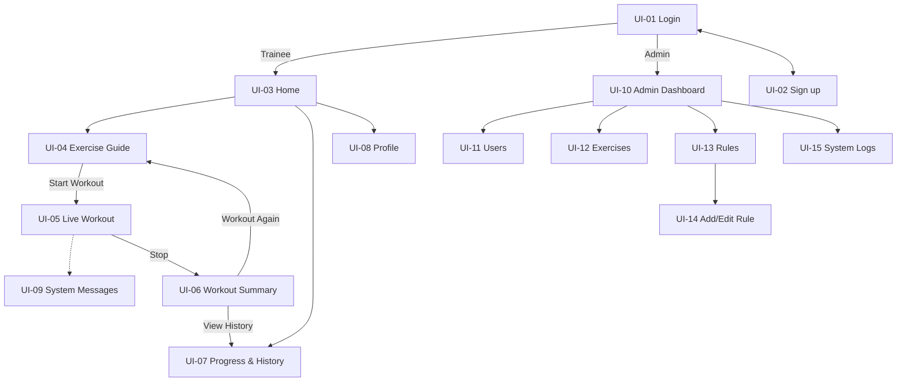

# AIFit – Đặc tả luồng & chức năng giao diện (dùng để nhờ AI dựng UI)

> Nguồn: Proposal v3.x + Interface Design Document v1.1 (C1SE.87).
> Cách dùng: dán **Phần A (Prompt tổng)** cho AI trước, sau đó dán từng màn hình ở **Phần D** (mỗi lần 1–3 màn) để AI dựng chi tiết.
> Ngôn ngữ chữ trên giao diện: **Tiếng Anh** (giống tài liệu IDD). Muốn tiếng Việt thì thêm câu "All UI text in Vietnamese".

---

## PHẦN A – PROMPT TỔNG (copy dán cho AI đầu tiên)

```
Build the front-end UI for "AIFit – AI-Powered Fitness Assistant", a desktop-first web app that
analyzes workout posture in real time from the webcam (MediaPipe Pose, runs in the browser) and gives
instant visual + voice feedback for 3 exercises: Squat, Plank, Push-up (one person in frame).

Tech: React + TypeScript + Tailwind CSS + React Router. Charts: Recharts. Icons: lucide-react.
Use mock data and a mock API layer (src/services/*.ts) so screens work without a backend.
The real backend later is ASP.NET Core REST API with JWT.

Two roles:
- Trainee: Login, Sign up, Home (exercise selection), Exercise Guide, Live Workout, Workout Summary,
  Progress & History, Profile, System Messages (dialogs/banners on the workout screen).
- Admin: Dashboard, Manage Users, Manage Exercises, Manage Exercise Rules, Add/Edit Rule, System Logs.

Design system:
- Brand: gold (#C9A227 primary, #A8841A hover) on cream/beige background (#FAF6EC, cards #FFFFFF,
  borders #E8DFC8), dark text #2B2B2B.
- Semantic colors: Green #16A34A = correct posture / success; Red #DC2626 = incorrect posture / error /
  delete / joint causing the error; Orange #EA580C = warnings, correction hints, detection lost.
- Rounded cards (rounded-2xl), soft shadows, generous spacing, clean sans-serif font (Inter).
- Desktop-first, responsive down to tablet. Accessible contrast, visible focus states.

Rules:
- A trainee must be able to start a workout in 2 clicks (exercise card -> Start Workout).
- Video is never uploaded; show a privacy note "Video is processed in your browser and never stored."
- Every posture error is shown on screen AND spoken (voice), with a cooldown.
- Every screen needs loading, empty and error states.
```

---

## PHẦN B – DESIGN SYSTEM & THÀNH PHẦN DÙNG CHUNG

### B1. Màu & ý nghĩa
| Màu | Dùng cho |
|---|---|
| Gold `#C9A227` | Nút chính, link active, logo, thanh điều hướng đang chọn |
| Cream `#FAF6EC` | Nền trang |
| Green `#16A34A` | CORRECT, rep đúng, lưu thành công, đồng bộ OK |
| Red `#DC2626` | INCORRECT, rep sai, lỗi, nút xóa, khớp gây lỗi trên skeleton |
| Orange `#EA580C` | Gợi ý sửa tư thế, cảnh báo, mất nhận diện cơ thể, offline |

### B2. Component dùng chung
- `TopNavbar` (Trainee): logo AIFit | Home | History | Profile | avatar (chữ cái đầu tên) | Logout.
- `AdminSidebar`: Dashboard, Users, Exercises, Exercise Rules, System Logs + khối tài khoản admin + Logout ở dưới.
- `StatCard`: label + số lớn + (tùy chọn) màu ngữ nghĩa.
- `DataTable`: header, phân trang, trạng thái rỗng, loading skeleton.
- `ConfirmDialog`: tiêu đề, nội dung, nút Cancel / Confirm (đỏ nếu xóa).
- `Toast`: success (xanh), error (đỏ), warning (cam).
- `Banner`: dải thông báo phủ trên video (cam/đỏ).
- `FormField`: label, input, dòng lỗi đỏ bên dưới.
- `PrivacyNote`: icon khóa + "Video is processed in your browser and never stored."

### B3. Điều hướng & phân quyền (routes)
| Route | Màn | Quyền |
|---|---|---|
| `/login` | UI-01 Login | Public |
| `/signup` | UI-02 Sign up | Public |
| `/` | UI-03 Home | Trainee |
| `/exercise/:id/guide` | UI-04 Exercise Guide | Trainee |
| `/exercise/:id/workout` | UI-05 Live Workout (+ UI-09 overlay) | Trainee |
| `/session/:id/summary` | UI-06 Workout Summary | Trainee |
| `/history` | UI-07 Progress & History | Trainee |
| `/history/:sessionId` | Chi tiết buổi (layout UI-06, chỉ đọc) | Trainee |
| `/profile` | UI-08 Profile | Trainee |
| `/admin` | UI-10 Dashboard | Admin |
| `/admin/users` | UI-11 Manage Users | Admin |
| `/admin/exercises` | UI-12 Manage Exercises | Admin |
| `/admin/rules` | UI-13 Manage Rules | Admin |
| `/admin/rules/new`, `/admin/rules/:id/edit` | UI-14 Add/Edit Rule | Admin |
| `/admin/logs` | UI-15 System Logs | Admin |

- Chưa đăng nhập vào trang bảo vệ → chuyển về `/login`.
- Trainee vào `/admin/*` → chuyển về `/`. Admin đăng nhập → vào `/admin`.
- JWT lưu trong bộ nhớ/localStorage; Logout xóa token → `/login`.

---

## PHẦN C – CÁC LUỒNG CHÍNH

### C1. Sơ đồ tổng


### C2. Luồng đăng ký – đăng nhập
1. Người dùng mới ở UI-01 bấm "Sign up" → UI-02.
2. Nhập Full name, Email, Password, Confirm → bấm Create account.
3. Validate: bắt buộc hết; email đúng định dạng & chưa tồn tại; password 8–50 ký tự; confirm trùng.
4. Thành công → về UI-01 kèm toast xanh "Account created. Please log in."
5. Ở UI-01 nhập email + password → Log in.
   - Sai → dòng đỏ "Invalid email or password."
   - Tài khoản bị khóa → dòng đỏ "Your account has been locked. Please contact the administrator."
   - Đúng → nhận JWT → Trainee vào UI-03, Admin vào UI-10.

### C3. Luồng tập luyện (luồng cốt lõi)
1. UI-03: bấm 1 thẻ bài tập (click 1) → UI-04 của bài đó.
2. UI-04: đọc hướng dẫn tư thế + cách đặt camera → bấm **Start Workout** (click 2).
3. UI-05 mở, trình duyệt xin quyền camera:
   - Từ chối → UI-09 dialog "Camera permission denied" (Try again / Back to Home).
   - Cho phép → hiển thị trạng thái "Loading pose model..." → đếm ngược 3-2-1 → bắt đầu phân tích.
4. Trong lúc tập (mỗi frame):
   - Vẽ skeleton lên video; khớp gây lỗi tô đỏ + hiện số góc.
   - Badge trạng thái CORRECT (xanh) / INCORRECT (đỏ).
   - Hoàn thành chu kỳ top → bottom → top ⇒ Total reps +1, và +1 vào Correct hoặc Incorrect.
   - Có lỗi → thanh phản hồi hiện "lỗi + gợi ý sửa" (cam) và đọc bằng giọng; cùng một lỗi không đọc lại trong khoảng cooldown (vd 3 giây).
   - Mất cơ thể khỏi khung → banner cam "Body not detected" phủ video, tạm dừng đếm, tự ẩn khi thấy lại người.
   - Mất mạng → banner "Offline" (vẫn tập được, chỉ ảnh hưởng lúc lưu).
5. Nút điều khiển: Pause/Resume (dừng phân tích + đồng hồ), Voice On/Off (chữ trên màn hình vẫn hiện), Stop.
6. Bấm Stop → ConfirmDialog "End workout and save result?" → lưu → UI-06.

### C4. Luồng lưu kết quả & offline
1. Kết thúc buổi → gửi JSON tóm tắt (không có video) lên server.
2. Thành công → UI-06 hiện "✓ Session saved to server" (xanh).
3. Thất bại/offline → lưu tạm localStorage, UI-06 hiện "Offline – will retry" (cam) + nút **Retry sync**; khi có mạng lại tự đồng bộ.
4. Từ UI-06: "Workout Again" → UI-04 cùng bài; "View History" → UI-07.

### C5. Luồng xem tiến độ
UI-07 → chọn bộ lọc bài tập + khoảng thời gian → số liệu tổng + 2 biểu đồ + bảng cập nhật → bấm "View" ở một dòng → chi tiết buổi (layout UI-06, chỉ đọc, không có nút đồng bộ).

### C6. Luồng hồ sơ
UI-08 → sửa Full name → Save (toast xanh). Đổi mật khẩu: Current / New / Confirm → Update password (sai mật khẩu hiện tại → lỗi đỏ). Logout → UI-01.

### C7. Luồng Admin
- **Users:** tìm/lọc → Lock/Unlock (đổi Status Active ↔ Locked, có xác nhận) → Delete (ConfirmDialog đỏ).
- **Exercises:** Add → form dưới bảng → Save. Edit → form điền sẵn. Remove = chuyển Inactive (ẩn với trainee, giữ dữ liệu buổi tập cũ). Toggle Active/Inactive ngay trên dòng.
- **Rules:** lọc theo bài → Add / Edit (mở UI-14). **Lưu khi Edit tạo phiên bản mới** (version +1, bản cũ giữ làm lịch sử). Deactivate thay vì xóa (rule không bao giờ bị xóa).
- **Logs:** lọc theo thời gian & loại → bảng → Export (CSV).
- **Dashboard:** xem chỉ số, biểu đồ, chất lượng nhận diện; Export report theo khoảng thời gian.

---

## PHẦN D – ĐẶC TẢ CHI TIẾT TỪNG MÀN HÌNH

### UI-01 Login (`/login`)
**Bố cục:** chia 2 cột – trái: ảnh/minh họa người tập + slogan "Your AI personal trainer at home"; phải: thẻ form căn giữa.
| # | Thành phần | Hành vi |
|---|---|---|
| 1 | Email (text box) | Bắt buộc, kiểm tra định dạng email |
| 2 | Password (ẩn mặc định) | Bắt buộc |
| 3 | Icon con mắt Show/Hide | Bật/tắt hiện mật khẩu |
| 4 | Dòng lỗi đỏ | "Invalid email or password." – chỉ hiện khi đăng nhập thất bại |
| 5 | Nút **Log in** (gold, full width) | Loading spinner khi gửi; thành công → điều hướng theo role |
| 6 | Link "Don't have an account? Sign up" | → UI-02 |

### UI-02 Sign up (`/signup`)
Cùng bố cục UI-01.
| # | Thành phần | Hành vi |
|---|---|---|
| 1 | Full name | Bắt buộc |
| 2 | Email | Bắt buộc, duy nhất ("Email already exists.") |
| 3 | Password | 8–50 ký tự, có show/hide, hiển thị gợi ý độ dài |
| 4 | Confirm password | Phải trùng ("Passwords do not match.") |
| 5 | Nút **Create account** | Thành công → UI-01 + toast xanh |
| 6 | Link "Already have an account? Log in" | → UI-01 |

### UI-03 Home – Exercise selection (`/`)
| # | Thành phần | Hành vi |
|---|---|---|
| 1 | TopNavbar | Home / History / Profile / avatar / Logout |
| 2 | Lời chào | "Hi, {name} 👋 Choose an exercise to start your workout." |
| 3 | Thẻ **Squat** | Ảnh, tên, "Joints: Hip › Knee › Ankle", nhãn "Reps" → UI-04 |
| 4 | Thẻ **Plank** | "Joints: Shoulder › Hip › Ankle", nhãn "Hold time" → UI-04 |
| 5 | Thẻ **Push-up** | "Joints: Shoulder › Elbow › Wrist", nhãn "Reps" → UI-04 |
| 6 | Panel "Latest workout" | Bài, ngày, reps, accuracy (vòng % màu), thời lượng. **Ẩn với người dùng mới** (thay bằng "No workouts yet – start your first one!") |
| 7 | Link "View full history" | → UI-07 |

- 3 thẻ xếp lưới 3 cột, hover nổi lên + viền gold. Chỉ hiện bài có status Active.

### UI-04 Exercise Guide (`/exercise/:id/guide`)
| # | Thành phần | Hành vi |
|---|---|---|
| 1 | Link "← Back" | → UI-03 |
| 2 | Tiêu đề | "Squat – Exercise Guide" |
| 3 | Ảnh tư thế chuẩn | Ảnh minh họa tư thế chính |
| 4 | Danh sách "What AIFit checks" | Các điểm kiểm tra (xem nội dung từng bài bên dưới) |
| 5 | Hướng dẫn đặt camera | Hướng nhìn, khoảng cách, thấy toàn thân, đủ sáng + PrivacyNote |
| 6 | Nút **Start Workout** (gold, lớn) | → UI-05, xin quyền camera |

**Nội dung theo bài:**
- **Squat** – Kiểm tra: độ sâu gối (mục tiêu 90–110°), góc thân–cẳng chân, giữ lưng thẳng. Camera: đặt **ngang bên hông** (side view), cách 2–3 m, thấy từ đầu đến chân.
- **Plank** – Kiểm tra: vai–hông–cổ chân thẳng hàng 165–180°, không võng hông, không nhô hông. Camera: **side view**, ngang tầm sàn/hông, cách ~2 m.
- **Push-up** – Kiểm tra: khuỷu gập ≤ 90° ở đáy và duỗi ~180° ở đỉnh, khuỷu không mở quá 75–90° so với thân, thân thẳng 165–180°. Camera: **side view**, cách ~2 m.

### UI-05 Live Workout (`/exercise/:id/workout`) – MÀN QUAN TRỌNG NHẤT
**Bố cục:** trái ~70%: khung video lớn; phải ~30%: cột số liệu; dưới video: thanh phản hồi; dưới cùng: thanh nút điều khiển.
| # | Thành phần | Hành vi |
|---|---|---|
| 1 | Video + Canvas skeleton | Chấm khớp + đường nối màu trắng/gold; khớp lỗi màu **đỏ** kèm nhãn góc (vd "82°") |
| 2 | Badge trạng thái | **CORRECT** (nền xanh) / **INCORRECT** (nền đỏ), góc trên video |
| 3 | Total reps | Số lớn, tăng khi đủ chu kỳ top-bottom-top (có hiệu ứng nhảy số) |
| 4 | Correct reps | Màu xanh |
| 5 | Incorrect reps | Màu đỏ |
| 6 | Accuracy | = correct / total × 100%, thanh tiến độ |
| 7 | Timer | mm:ss |
| 8 | Thanh phản hồi | Icon loa + câu lỗi + gợi ý, nền cam; khi đúng hiện "Great form! Keep going." nền xanh |
| 9 | Nút Pause / Resume | Dừng phân tích + timer; overlay "Paused" mờ trên video |
| 10 | Nút Voice On / Off | Icon loa / loa gạch; chữ phản hồi vẫn hiện |
| 11 | Nút **Stop** (đỏ) | Confirm → lưu → UI-06 |

**Biến thể Plank (bài tĩnh):** thay Total reps → **Hold time**; Correct → **Correct hold time**; Incorrect → **Incorrect hold time**; Accuracy = thời gian đúng / tổng thời gian.

**Trạng thái màn:** Requesting camera → Loading pose model → Countdown 3-2-1 → Running → Paused → Body not detected → Saving.

**Câu phản hồi mẫu (hiển thị + đọc):**
| Bài | Lỗi | Câu nói |
|---|---|---|
| Squat | Squat chưa đủ sâu (< 90°) | "Go lower – bend your knees to about 90 degrees." |
| Squat | Quá sâu (> 110°) | "Careful, you are going too deep. Control your depth." |
| Squat | Thân đổ quá nhiều (trunk–tibia > +10°) | "Keep your chest up." |
| Plank | Võng hông | "Your hips are sagging. Lift your hips." |
| Plank | Nhô hông | "Your hips are too high. Lower your hips." |
| Push-up | Chưa xuống đủ (> 90°) | "Lower your chest until your elbows reach 90 degrees." |
| Push-up | Mở khuỷu quá rộng | "Keep your elbows closer to your body." |
| Push-up | Thân không thẳng | "Keep your body in a straight line." |

### UI-06 Workout Summary (`/session/:id/summary`)
| # | Thành phần | Hành vi |
|---|---|---|
| 1 | Tiêu đề | "Squat – Workout Summary · 22 Nov 2026, 12:30" |
| 2 | Duration | StatCard |
| 3 | Total reps (Plank: Hold time) | StatCard |
| 4 | Correct reps | StatCard xanh |
| 5 | Incorrect reps | StatCard đỏ |
| 6 | Accuracy | Vòng tròn % lớn |
| 7 | Danh sách lỗi | Nhãn lỗi + số rep bị ảnh hưởng (vd "Insufficient squat depth – 3 reps") |
| 8 | Biểu đồ từng rep | Các ô/cột theo thứ tự rep: xanh = đúng, đỏ = sai, hover hiện lỗi |
| 9 | Trạng thái đồng bộ | "✓ Session saved to server" (xanh) hoặc "Offline – will retry" (cam) + nút Retry sync |
| 10 | Nút **Workout Again** | → UI-04 cùng bài |
| 11 | Nút **View History** | → UI-07 |

### UI-07 Progress & History (`/history`)
| # | Thành phần | Hành vi |
|---|---|---|
| 1 | Combo Exercise | All / Squat / Plank / Push-up |
| 2 | Combo Period | Last 7 days / Last 30 days / All |
| 3 | 3 StatCard | Total sessions · Total reps · Average accuracy (theo bộ lọc) |
| 4 | Line chart | Accuracy (%) theo thời gian |
| 5 | Stacked bar chart | Correct (xanh) + Incorrect (đỏ) mỗi buổi |
| 6 | Bảng lịch sử | Date, Exercise, Duration, Reps, Correct, Incorrect, Accuracy; cuộn + phân trang |
| 7 | Nút "View" mỗi dòng | → chi tiết buổi (layout UI-06, chỉ đọc) |
- Rỗng: "No workouts in this period." + nút "Start a workout".

### UI-08 Profile (`/profile`)
2 thẻ: **Personal information** và **Change password**.
| # | Thành phần | Hành vi |
|---|---|---|
| 1 | Avatar | Vòng tròn gold, chữ cái đầu tên |
| 2 | Full name | Sửa được, bắt buộc |
| 3 | Email | Chỉ đọc (xám) |
| 4 | Nút Save changes | Toast xanh "Profile updated." |
| 5 | Current password | Bắt buộc |
| 6 | New password | 8–50 ký tự |
| 7 | Confirm new password | Phải trùng |
| 8 | Nút Update password | Sai mật khẩu hiện tại → lỗi đỏ; đúng → toast xanh |
| 9 | Nút Log out | → UI-01 |

### UI-09 System Messages (overlay trên UI-05)
| # | Loại | Nội dung / hành vi |
|---|---|---|
| 1 | Dialog | **Camera permission denied** – giải thích vì sao cần camera + hướng dẫn bật quyền trong trình duyệt (icon camera gạch) |
| 2 | Nút Try again / link Back to Home | Xin quyền lại / → UI-03 |
| 3 | Banner cam trên video | **Body not detected** – "Step back so your whole body is visible." Video mờ, tạm dừng đếm, tự ẩn khi thấy lại |
| 4 | Banner trên cùng | **You are offline** – "Your result will be saved in this browser and synced later." |
| 5 | Nút Retry sync | Gửi lại bản tóm tắt đã lưu |

---

### UI-10 Admin Dashboard (`/admin`)
**Bố cục:** AdminSidebar trái + nội dung phải.
| # | Thành phần | Hành vi |
|---|---|---|
| 1 | Sidebar | Dashboard, Users, Exercises, Exercise Rules, System Logs |
| 2 | Khối tài khoản | Tên admin + Logout |
| 3 | 4 StatCard | Total users · Sessions (last 7 days) · Average accuracy · System errors (last 24h, đỏ nếu > 0) |
| 4 | Nút Export report | Chọn khoảng thời gian → tải CSV |
| 5 | Biểu đồ cột/đường | Số buổi tập mỗi ngày |
| 6 | Bảng chất lượng nhận diện | Exercise · Avg landmark visibility (%) · Avg FPS (đỏ nếu < 20) · Body-lost events |
| 7 | Bảng lỗi mới nhất | 5 dòng: Time, User, Type, Message + link "View all" → UI-15 |

### UI-11 Manage Users (`/admin/users`)
| # | Thành phần | Hành vi |
|---|---|---|
| 1 | Search box | Tìm theo tên/email (debounce) |
| 2 | Combo Role | All / Trainee / Admin |
| 4 | Bảng | No., Full name, Email, Role, Status (badge Active xanh / Locked đỏ), Created date |
| 5 | Nút Lock / Unlock | Có xác nhận; đổi badge Status |
| 6 | Nút Delete (đỏ) | ConfirmDialog "Delete this user? This cannot be undone." |
| 7 | Phân trang | Prev / số trang / Next |

### UI-12 Manage Exercises (`/admin/exercises`)
| # | Thành phần | Hành vi |
|---|---|---|
| 1 | Nút + Add exercise | Mở form bên dưới bảng (trống) |
| 2 | Bảng | No., Name, Description, Joint set, Status |
| 3 | Nút Edit | Mở form điền sẵn |
| 4 | Nút Remove | Chuyển Inactive, ẩn với trainee, giữ dữ liệu buổi tập; có xác nhận |
| 5 | Toggle trên dòng | Active / Inactive |
| 6 | Form: Name | Bắt buộc |
| 7 | Form: Joint set | vd "Hip > Knee > Ankle" |
| 8 | Form: Status | Active / Inactive |
| 9 | Form: Description | Text area |
| 10 | Nút Save | Validate → toast xanh |
| 11 | Nút Cancel | Đóng form |

### UI-13 Manage Exercise Rules (`/admin/rules`)
Ghi chú đầu trang: "Changing a rule changes the evaluation without re-coding."
| # | Thành phần | Hành vi |
|---|---|---|
| 1 | Combo Exercise | Lọc rule theo bài |
| 2 | Nút + Add rule | → UI-14 trống |
| 3 | Bảng | Exercise, Joint set / Phase, Metric, Threshold (vd "90°–110°", "< 165°"), Type (Correct xanh / Error đỏ), Label, Ref., Version, Status |
| 4 | Nút Edit | → UI-14 điền sẵn; lưu tạo **version mới** |
| 5 | Nút Deactivate | Rule không bao giờ bị xóa; bản cũ giữ làm lịch sử |

### UI-14 Add / Edit Rule (`/admin/rules/new`, `/:id/edit`)
| # | Trường | Validate |
|---|---|---|
| 1 | Exercise (combo) | Bắt buộc |
| 2 | Joint set / Phase | Bắt buộc, vd "Hip > Knee > Ankle" |
| 3 | Metric | Bắt buộc, vd "Knee-flexion depth" |
| 4 | Min angle (°) | Có thể trống (mở dưới); Min < Max |
| 5 | Max angle (°) | Có thể trống (mở trên); Min < Max; không được trống cả hai |
| 6 | Rule type | Correct / Error |
| 7 | Reference | vd "Ref. 3.3" |
| 8 | Classification / Error label | Bắt buộc, chữ hiện trên màn tập |
| 9 | Voice alert message | Bắt buộc nếu type = Error |
| 10 | Nút Save | Validate; Edit → thông báo "Saved as version N" |
| 11 | Nút Cancel | → UI-13 |

### UI-15 System Logs (`/admin/logs`)
| # | Thành phần | Hành vi |
|---|---|---|
| 1 | Combo Period | Last 24h / 7 days / 30 days / All |
| 2 | Combo Type | All / Camera denied / Body lost / Sync failed / API error |
| 3 | Nút Export | Tải CSV theo bộ lọc |
| 4 | Bảng | Time, User, Exercise, Type (badge màu), Message |
| 5 | Phân trang | |

---

## PHẦN E – DỮ LIỆU MẪU (mock) CHO AI

```json
{
  "users": [
    { "id": 1, "fullName": "Tran Thi Yen Nhi", "email": "nhi@aifit.com", "role": "Trainee", "status": "Active", "createdAt": "2026-09-01" },
    { "id": 2, "fullName": "Admin AIFit", "email": "admin@aifit.com", "role": "Admin", "status": "Active", "createdAt": "2026-08-21" }
  ],
  "exercises": [
    { "id": 1, "name": "Squat",   "jointSet": "Hip > Knee > Ankle",       "mode": "reps", "status": "Active" },
    { "id": 2, "name": "Plank",   "jointSet": "Shoulder > Hip > Ankle",   "mode": "hold", "status": "Active" },
    { "id": 3, "name": "Push-up", "jointSet": "Shoulder > Elbow > Wrist", "mode": "reps", "status": "Active" }
  ],
  "exerciseRules": [
    { "id": 1, "exercise": "Squat", "jointSet": "Hip>Knee>Ankle", "metric": "Knee-flexion depth", "min": 0,   "max": 90,  "type": "Error",   "label": "Insufficient squat depth", "voice": "Go lower – bend your knees to about 90 degrees.", "ref": "3.3", "version": 1, "status": "Active" },
    { "id": 2, "exercise": "Squat", "jointSet": "Hip>Knee>Ankle", "metric": "Knee-flexion depth", "min": 90,  "max": 110, "type": "Correct", "label": "Medium depth (target)", "ref": "3.3", "version": 1, "status": "Active" },
    { "id": 3, "exercise": "Squat", "jointSet": "Hip>Knee>Ankle", "metric": "Knee-flexion depth", "min": 110, "max": 135, "type": "Error",   "label": "Full depth – monitor joint load", "voice": "Careful, you are going too deep.", "ref": "3.3", "version": 1, "status": "Active" },
    { "id": 4, "exercise": "Squat", "jointSet": "Trunk–Tibia", "metric": "Trunk–tibia angle", "min": -10, "max": 10, "type": "Correct", "label": "Neutral bias", "ref": "3.1, 3.2", "version": 1, "status": "Active" },
    { "id": 5, "exercise": "Plank", "jointSet": "Shoulder>Hip>Ankle", "metric": "Body-alignment angle", "min": 165, "max": 180, "type": "Correct", "label": "Correct alignment", "ref": "3.4", "version": 1, "status": "Active" },
    { "id": 6, "exercise": "Plank", "jointSet": "Shoulder>Hip>Ankle (hip below line)", "metric": "Body-alignment angle", "min": null, "max": 165, "type": "Error", "label": "Hips sagging", "voice": "Your hips are sagging. Lift your hips.", "ref": "3.4", "version": 1, "status": "Active" },
    { "id": 7, "exercise": "Plank", "jointSet": "Shoulder>Hip>Ankle (hip above line)", "metric": "Body-alignment angle", "min": null, "max": 165, "type": "Error", "label": "Hips piking", "voice": "Your hips are too high. Lower your hips.", "ref": "3.4", "version": 1, "status": "Active" },
    { "id": 8, "exercise": "Push-up", "jointSet": "Shoulder>Elbow>Wrist", "metric": "Elbow-flexion ROM", "min": null, "max": 90, "type": "Correct", "label": "Valid repetition (bottom)", "ref": "3.5", "version": 1, "status": "Active" },
    { "id": 9, "exercise": "Push-up", "jointSet": "Torso>Shoulder>Elbow", "metric": "Elbow-flare angle", "min": 75, "max": null, "type": "Error", "label": "Excessive elbow flare", "voice": "Keep your elbows closer to your body.", "ref": "3.5", "version": 1, "status": "Active" },
    { "id": 10, "exercise": "Push-up", "jointSet": "Shoulder>Hip>Ankle", "metric": "Body-alignment angle", "min": 165, "max": 180, "type": "Correct", "label": "Straight body", "ref": "3.4, 3.5", "version": 1, "status": "Active" }
  ],
  "workoutSessions": [
    { "id": 101, "exercise": "Squat", "date": "2026-11-21T18:30:00", "durationSec": 312, "totalReps": 20, "correctReps": 16, "incorrectReps": 4, "accuracy": 80,
      "errors": [ { "label": "Insufficient squat depth", "reps": 3 }, { "label": "Full depth – monitor joint load", "reps": 1 } ],
      "repResults": [1,1,0,1,1,1,0,1,1,1,1,1,0,1,1,1,0,1,1,1],
      "avgFps": 27, "avgVisibility": 0.91, "bodyLostCount": 1, "synced": true },
    { "id": 102, "exercise": "Plank", "date": "2026-11-20T07:10:00", "durationSec": 90, "correctHoldSec": 72, "incorrectHoldSec": 18, "accuracy": 80,
      "errors": [ { "label": "Hips sagging", "seconds": 18 } ], "avgFps": 28, "avgVisibility": 0.88, "bodyLostCount": 0, "synced": true }
  ],
  "systemLogs": [
    { "time": "2026-11-22T09:12:00", "user": "nhi@aifit.com", "exercise": "Squat", "type": "Body lost", "message": "Landmarks lost for 2.4s" },
    { "time": "2026-11-22T08:40:00", "user": "manh@aifit.com", "exercise": "Push-up", "type": "Camera denied", "message": "NotAllowedError: Permission denied" },
    { "time": "2026-11-21T21:05:00", "user": "nga@aifit.com", "exercise": "Plank", "type": "Sync failed", "message": "Network error – session cached locally" }
  ]
}
```

---

## PHẦN F – PROMPT MẪU THEO TỪNG ĐỢT (dán sau Prompt tổng)

1. **Đợt 1 – Nền tảng:** "Set up the project structure, design tokens, TopNavbar, AdminSidebar, shared components (StatCard, DataTable, ConfirmDialog, Toast, Banner, FormField, PrivacyNote), routing with role guards, and a mock auth service. Then build UI-01 Login and UI-02 Sign up exactly as specified: [dán UI-01, UI-02, luồng C2]."
2. **Đợt 2 – Trang chủ & hướng dẫn:** "Build UI-03 Home and UI-04 Exercise Guide: [dán UI-03, UI-04]."
3. **Đợt 3 – Màn tập:** "Build UI-05 Live Workout with UI-09 overlays. Use the real webcam via getUserMedia and a placeholder canvas skeleton; simulate reps/errors with a mock generator so the UI updates live. Use Web Speech API speechSynthesis with a 3s cooldown per error: [dán UI-05, UI-09, luồng C3]."
4. **Đợt 4 – Kết quả & lịch sử:** "Build UI-06 Summary, UI-07 History, UI-08 Profile: [dán UI-06/07/08, luồng C4–C6]."
5. **Đợt 5 – Admin:** "Build UI-10 to UI-15: [dán UI-10…UI-15, luồng C7]."

> Mẹo: yêu cầu AI giữ nguyên **số thứ tự control (#)** để đối chiếu với IDD; nhắc lại "2-click start", "no video upload", "voice + cooldown".
